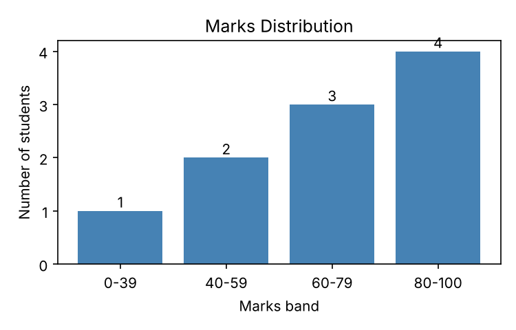

# Result Statistics Analyzer

**PS No. 81** | Rungta International Skills University
School of Computer Science and Engineering - B.Tech CSE, First Semester

A Python 3 console program that reads student marks from `results.csv` and shows
statistics, pass percentage and a marks distribution bar chart.

## Features
- Reads `results.csv` (`RollNo`, `Marks`) using **Pandas**
- Handles a missing file and a file with only the header row
- Skips marks outside 0-100 (or non-numeric) with a warning
- Calculates mean, median, mode, highest, lowest and standard deviation (`np.std`) using **NumPy** / Pandas
- Pass percentage (pass mark = 40)
- Student count in bands **0-39, 40-59, 60-79, 80-100** with a **Matplotlib** bar chart
- Simple console menu

## Concepts used
Pandas, NumPy, Visualization, Statistics

## Project structure
```
result-statistics-analyzer/
├── result_analyzer.py     # main program
├── results.csv            # sample data
├── run_tests.py           # runs all 4 test cases
├── test_data/             # CSV files for the test cases
├── screenshots/           # chart output
├── requirements.txt
└── README.md
```

## Installation
```bash
git clone https://github.com/samriddhi-shraddha/result-statistics-analyzer.git
cd result-statistics-analyzer
pip install -r requirements.txt
```

## Usage
```bash
python result_analyzer.py              # uses results.csv
python result_analyzer.py my_file.csv  # optional: use another CSV
```

Menu:
```
1. Show statistics
2. Pass percentage and distribution
3. Exit
```

### CSV format
```
RollNo,Marks
1,45
2,58
...
```

## Sample output (results.csv)
Option 1:
```
Students: 10
Mean: 70.20
Median: 72.00
Mode: 72.00
Highest: 95 | Lowest: 38
Standard deviation: 17.78
Pass percentage: 90.00%
```
Option 2:
```
Passed: 9 | Failed: 1 | Pass percentage: 90.00%
0-39 : 1
40-59 : 2
60-79 : 3
80-100 : 4
```


## Test cases
| # | Input | Result |
|---|-------|--------|
| 1 | Sample file, option 1 | Students 10, Median 72, Mode 72, Highest 95, Lowest 38 |
| 2 | One row `1,40`, option 1 | Std deviation 0.00, pass 100% |
| 3a | Extra row `11,120` | `Warning: Row 11 skipped - marks must be between 0 and 100.` |
| 3b | Header-only file | `No valid marks found. Nothing to analyse.` |
| 4 | Sample file, option 2 | Passed 9, Failed 1, bands 1 / 2 / 3 / 4, chart shown |

Run them all:
```bash
python run_tests.py
```

> Note: the sample marks add up to 702, so the program gives mean **70.20** and
> standard deviation **17.78** (population, `np.std`). The problem sheet lists 70.00 and 17.92.

## Author
Samriddhi Shraddha - ERP01502
